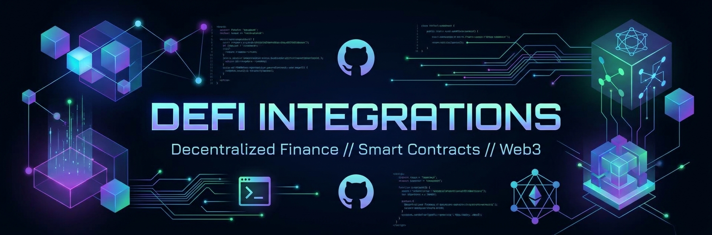

## DeFi Integrations

A playground of example smart contract integrations across DeFi protocols — Aave v4, Morpho Midnight, and Zama's Confidential Token Standard.

## ⚒️ Aave v4 — Liquidation Protection Manager

This repository contains example of a Position Manager contract called [`LiquidationProtectionManager`](https://github.com/CJ42/aave-v4-contracts-playground/blob/main/src/LiquidationProtectionManager.sol) that allows users to protect their position from being liquidated.

### Features

- Inherits [`PositionManagerBase`](https://github.com/aave/aave-v4/blob/main/src/position-manager/PositionManagerBase.sol) from Aave v4 to re-use pre-built Position Manager functionalities, such as registering spokes and setting the Position Manager contract for the user.
- Implement `HealthFactor` as user-defined value type for type safety over `uint256` primitive type.
- Implement multiple features from latest Solidity 0.8.x releases, such as free functions, import aliases, or operator aliases for user-defined value types.
- Mainnet fork tests against **Main Spoke** on Ethereum mainnet.

## 🌙 Morpho Midnight — Fixed-Term Position Manager

See [`Contracts/morpho-midnight`](./Contracts/morpho-midnight) for an example integration with [Morpho Midnight](https://docs.morpho.org/learn/concepts/midnight/), Morpho's fixed-rate, fixed-term lending protocol. Tested against a local deployment of the real Midnight contract (`cd Contracts/morpho-midnight && forge test`).

## 🔐 Zama — Confidential Token Standard (ERC-7984)

See [`Contracts/zama-confidential-token`](./Contracts/zama-confidential-token) for an example confidential token built on [Zama's FHEVM](https://docs.zama.org/protocol/protocol/overview) implementing [ERC-7984](https://www.zama.org/post/erc-7984-the-confidential-token-standard-explained).

## Table of Contents

- [Install dependencies](#install-dependencies)
  - [Usage](#usage)
    - [Build](#build)
    - [Run Mainnet Fork Tests](#run-mainnet-fork-tests)

## Requirements

- Foundry

Install or update Foundry:

```bash
curl -L https://foundry.paradigm.xyz | bash
foundryup
```

## Initial Setup

# Install dependencies

```bash
forge install
```

<!-- Update the `.env` file with the correct values.

- `RPC_URL` – RPC endpoint (Tenderly Virtual TestNet or public network).
- `SPOKE_ADDRESS` – Aave v4 spoke (e.g. Core on Ethereum mainnet: `0x89914a22E30CDf88A06e801E407ca82520210a79`).
- `RESERVE_ID` – Reserve identifier (e.g. `4` for USDC on Core).
- `PRIVATE_KEY` – Optional deployer key used by scripts (keep it secret).
- `TENDERLY_ACCESS_KEY` – Tenderly access token for verification. -->

## Usage

### Build

```shell
forge build
```

### Run Mainnet Fork Tests

```shell
forge test
```

<!-- ### Deploy

```shell
forge script script/Deploy_ReserveUtilization.s.sol:DeployReserveUtilization \
  --rpc-url <RPC_URL> \
  --broadcast
```

### Verify

#### Tenderly Virtual TestNet

```shell
forge verify-contract \
  <DEPLOYED_ADDRESS> \
  src/ReserveUtilization.sol:ReserveUtilization \
  --verifier-url <RPC_URL>/verify/etherscan \
  --etherscan-api-key <TENDERLY_ACCESS_KEY> \
  --watch
```

#### Etherscan (Public Networks)

```shell
forge verify-contract \
  <DEPLOYED_ADDRESS> \
  src/ReserveUtilization.sol:ReserveUtilization \
  --chain <CHAIN_ID> \
  --etherscan-api-key $ETHERSCAN_API_KEY
```

## License

Aave v4 Foundry Boilerplate [MIT licensed](./LICENSE) -->
