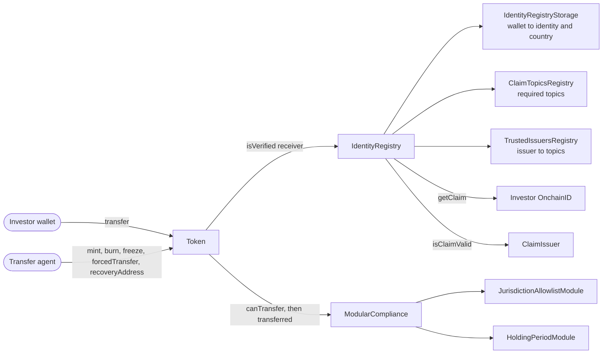

# 🦖 ERC-3643 (T-REX) — Tokenized Stock

An example RWA token: a **tokenized share class** issued on the unmodified [ERC-3643](https://eips.ethereum.org/EIPS/eip-3643) T-REX contracts. The rules of the offering are expressed as identity claims and two compliance modules, and the tests deploy the complete stack and run the full investor lifecycle against it.

> Educational example, not legal advice. The offering terms below are a simplified model of US private placement rules, and the two modules in this folder have not been audited.

## What ERC-3643 is

ERC-20 lets anyone hold and transfer a token. Securities cannot work that way: the issuer must know who holds them, and a transfer to an ineligible investor has to be impossible rather than merely prohibited. ERC-3643 (the **T-REX** protocol, for Token for Regulated EXchanges) is an ERC-20 extension that adds this at the token level:

- **Identity.** Each investor wallet links to an [OnchainID](https://github.com/onchain-id/solidity) identity contract (ERC-734 keys and ERC-735 claims). Trusted issuers sign claims such as "passed KYC", and investors keep them on their identity.
- **Eligibility.** A transfer only goes through if the **receiver** holds a valid claim, from a trusted issuer, for every required topic.
- **Compliance.** Offering-wide rules (country limits, lockups, investor caps) are pluggable modules, evaluated on every transfer.
- **Agent controls.** A transfer agent can freeze, pause, force a transfer and recover a lost wallet, which regulated securities require.

## Architecture



A `transfer` runs these steps in order, and any failure reverts it:

1. `Token`: not paused, neither wallet frozen, amount within the sender's unfrozen balance.
2. `IdentityRegistry.isVerified(to)`: for every topic in the `ClaimTopicsRegistry`, the receiver's identity holds a claim from an issuer in the `TrustedIssuersRegistry`, and that issuer still considers it valid.
3. `ModularCompliance.canTransfer`: every module's `moduleCheck` returns true.
4. The balances move, then `ModularCompliance.transferred` runs every module's `moduleTransferAction` hook.

## How the tokenized stock is wired

The contracts deployed for the token are T-REX's own. Everything specific to the stock is in [`src/`](./src):

| Rule | Reference | Enforced by |
| --- | --- | --- |
| Investor passed KYC / AML | | `CLAIM_TOPIC_KYC` claim, checked by `IdentityRegistry` |
| Investor is verified as accredited | [Rule 501(a)](https://www.ecfr.gov/current/title-17/chapter-II/part-230/section-230.501), [Rule 506(c)](https://www.ecfr.gov/current/title-17/chapter-II/part-230/section-230.506) | `CLAIM_TOPIC_ACCREDITED_INVESTOR` claim, checked by `IdentityRegistry` |
| Shares only reach allowed countries (US, UK) | Offering terms | [`JurisdictionAllowlistModule`](./src/modules/JurisdictionAllowlistModule.sol) |
| Issued shares are locked for one year | [Rule 144(d)](https://www.ecfr.gov/current/title-17/chapter-II/part-230/section-230.144) (non-reporting issuer) | [`HoldingPeriodModule`](./src/modules/HoldingPeriodModule.sol) |
| Court orders, lost wallets, sanctions | Transfer agent duties | T-REX `forcedTransfer`, `recoveryAddress`, freeze and pause |

[`TokenizedStockSuite`](./src/TokenizedStockSuite.sol) turns those terms into the arguments of `TREXFactory.deployTREXSuite`, which deploys the suite atomically. The token has 0 decimals because shares are whole units.

### Why these modules

Accreditation is a property of the investor, so it belongs in a claim. The country limit and the lockup are properties of the offering, so they belong in modules. The lockup is the rule that most distinguishes restricted stock from an allowlisted ERC-20, because it depends on *when each share was issued* and not only on who holds it.

Design decisions worth reviewing:

- **Default-deny jurisdictions.** No country is allowed until the issuer lists one. Only the receiver is checked, so an investor who moves abroad can still sell.
- **Locks follow the shares on agent actions.** `forcedTransfer`, `recoveryAddress` and `burn` bypass `moduleCheck`. When they take locked shares, `HoldingPeriodModule` moves those locks to the receiver with their original release time, so a wallet recovery or a court-ordered transfer cannot launder a lockup. The invariant `locked <= balance` is fuzz-tested.
- **Hooks do not revert.** A reverting hook would block an agent action, so the per-wallet lock cap (which bounds the gas of every transfer) merges into the newest lock instead of failing, and merging can only delay a release.
- **Locks are per wallet, balances are read from the token.** The module keeps no balance copy that could drift when an agent updates the registry. Moving locked shares to another wallet of the same investor takes an agent action (`recoveryAddress` or `forcedTransfer`).
- **Claims have no on-chain expiry.** `ClaimIssuer.isClaimValid` checks the signature and revocation only, so re-verification is an operational process: the claim issuer revokes a claim when an accreditation lapses (`test_Transfer_RevertsWhen_RecipientAccreditationIsRevoked`). A revoked seller can still exit, since T-REX only verifies the receiver.

### Integration notes on T-REX 4.1.3

- The token deploys **paused**, and an agent has to `unpause` it. `mint` and `forcedTransfer` work while paused.
- `deployTREXSuite` transfers every contract to the owner **except the `IdentityRegistryStorage`** it deployed. Call `recoverContractOwnership` on it, because `changeImplementationAuthority` requires the caller to own every contract of the suite.
- The factory needs to be registered once on the identity factory with `IdFactory.addTokenFactory`.
- Modules are shared infrastructure: their settings are keyed by compliance contract and changed through `ModularCompliance.callModuleFunction`, which only the compliance owner can call.

## Adapting it to another RWA

The token contract does not change. Replace the claim topics, the modules and the settings in `TokenizedStockSuite`:

| Asset | Claims | Modules | Other changes |
| --- | --- | --- | --- |
| **Rule 144A corporate bond** | KYC, Qualified Institutional Buyer | A new module blocking transfers around each coupon record date | Decimals matching the denomination, redeem at maturity with `burn` |
| **Private fund share** | KYC, Qualified Purchaser for a 3(c)(7) fund | `JurisdictionAllowlistModule`, plus a holder cap for a 3(c)(1) fund, keyed by identity because that limit counts beneficial owners | Subscriptions and NAV live in a separate contract that calls `mint` as an agent |
| **Fractional real estate** | KYC | `JurisdictionAllowlistModule`, plus a per-investor balance cap | Rent distribution through a separate contract |

To add a rule, inherit `AbstractModuleUpgradeable` and implement the `IModule` functions. Key all state by compliance contract, guard the hooks with `onlyComplianceCall`, put the rule in `moduleCheck`, and remember that `moduleCheck` is skipped for agent actions while the hooks are not.

## Build & test

A standalone Foundry project that reuses the root `lib/` submodules:

```bash
git submodule update --init lib/forge-std lib/erc-3643 lib/onchain-id lib/openzeppelin-contracts-v4 lib/openzeppelin-contracts-upgradeable-v4
cd contracts/erc3643-rwa-token
forge test
```

The 60 tests deploy every contract through `TREXFactory` (see [`TokenizedStockFixture`](./test/utils/TokenizedStockFixture.sol)) and cover minting, the holding period with several tranches, missing and revoked claims, an untrusted issuer, country rules, forced transfers, wallet recovery, freezing, pausing, access control, module upgrades, and a fuzz test of the lock accounting. They run on a local chain instead of a fork because there is no canonical deployment: every ERC-3643 issuer owns its own suite.

Three constraints come from T-REX and differ from the other integrations here:

- **Solidity 0.8.17.** Upstream pins this exact version, so this project uses `if (...) revert` rather than `require(cond, Error())`, and declares events in a library because file-level events need 0.8.22.
- **OpenZeppelin v4.** T-REX needs v4 while the repository root uses v5, so `lib/` holds a separate v4 install. Remappings in `foundry.toml` are explicit, and the root `remappings.txt` scopes v4 to imports from the T-REX libraries.
- **GPL-3.0.** T-REX and OnchainID are GPL-3.0, and these contracts inherit from them, so this folder is GPL-3.0 even though the repository root is MIT.

## Choosing the dependency

`TokenySolutions/T-REX` is archived and points to [`ERC-3643/ERC-3643`](https://github.com/ERC-3643/ERC-3643), pinned here at tag `4.1.3`, the latest stable release of the official repository. That repository ships no concrete compliance modules. Tokeny's archived 4.1.6 release has some, but they carry an additional CC BY-NC (non-commercial) license, so this example writes its own.

## Sources

- Standard: [EIP-3643](https://eips.ethereum.org/EIPS/eip-3643) · Code: https://github.com/ERC-3643/ERC-3643 · https://github.com/onchain-id/solidity
- Rules: [17 CFR 230.144](https://www.ecfr.gov/current/title-17/chapter-II/part-230/section-230.144), [230.501](https://www.ecfr.gov/current/title-17/chapter-II/part-230/section-230.501), [230.506](https://www.ecfr.gov/current/title-17/chapter-II/part-230/section-230.506)
